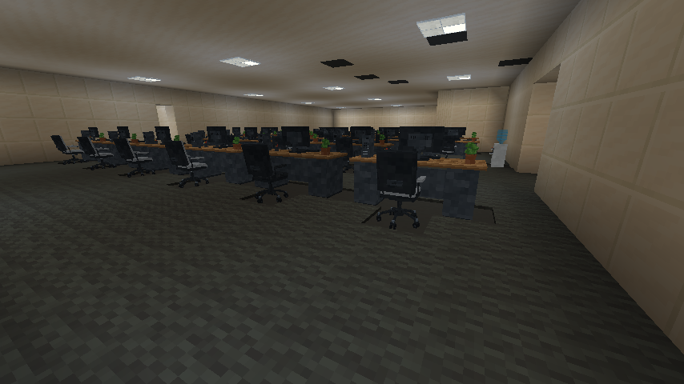

# Office Rooms

*A new liminal dimension for Minecraft: an endless office full of empty halls, strange megastructures and things that move when you're not looking. You feel alone. Unfortunately, you're not.*

**Version 0.40.0 (beta): a liminal office dimension with furniture, light, special rooms, megastructures, creatures, its own gear and music**

> **New in 0.40.0 (beta):** the quest book installs itself when FTB Quests is present and merges into a modpack's quest book ([docs/NEW_IN_0.40.0.md](docs/NEW_IN_0.40.0.md)). **0.39.1:** logo, credits and license in the mod list, cleanup ([docs/NEW_IN_0.39.1.md](docs/NEW_IN_0.39.1.md)). **0.39.0:** rare field stations on land and drilling rigs on the ocean as new research outposts ([docs/NEW_IN_0.39.0.md](docs/NEW_IN_0.39.0.md)). **0.38.1:** fixes for Poolrooms, hotel stairs and ramps ([docs/NEW_IN_0.38.1.md](docs/NEW_IN_0.38.1.md)). **0.38.0:** the Underside Key needs the cinema Ticket Stub; new quests for the cinema, hotel, slides and Aranea Membri ([docs/NEW_IN_0.38.0.md](docs/NEW_IN_0.38.0.md)). **0.37.1:** fixes for the cinema stairs, Aranea spawns and Hazard Zones in the cinema ([docs/NEW_IN_0.37.1.md](docs/NEW_IN_0.37.1.md)). **0.37.0:** the Abandoned Cinema is a three-floor multiplex with 36 screens, a lobby atrium with galleries and freestanding stairs ([docs/NEW_IN_0.37.0.md](docs/NEW_IN_0.37.0.md)). **0.36.1:** Refurbished Furniture in the Hotel and the Neighbourhood. **0.36.0:** the Hotel is a labyrinth of small rooms with a purpose, winding corridors and L-shaped staircases over seven storeys; more storeys and new room kinds for the Industrial Complex, Level Fun and the Neighbourhood (new worlds). See [docs/NEW_IN_0.36.0.md](docs/NEW_IN_0.36.0.md).

> **New in 0.35.1 (beta):** The Poolrooms water slides are round pipes coming out of the walls. See [docs/NEW_IN_0.35.1.md](docs/NEW_IN_0.35.1.md) and [docs/NEW_IN_0.35.0.md](docs/NEW_IN_0.35.0.md).

> **New in 0.29.0 (beta):** six new special rooms (cold storage, last meeting, mail room, rain room, canteen, arcade), Old Coins and vending machines, quest chapter "Curiosities". See [docs/NEW_IN_0.29.0.md](docs/NEW_IN_0.29.0.md).

> **New in 0.28.1 (beta):** more liminal Poolrooms (depths, drained and children's pools, benches, lifeguard chairs, arches to nowhere, haze and ripples). See [docs/NEW_IN_0.28.1.md](docs/NEW_IN_0.28.1.md).

> **New in 0.28.0 (beta):** hotel wall fix and hotel rework (room kinds, "do not disturb" rooms, sconces, ice machines, carts; new worlds). See [docs/NEW_IN_0.28.0.md](docs/NEW_IN_0.28.0.md).

> **New in 0.27.1 (beta):** a creepier, faster Hound. See [docs/NEW_IN_0.27.1.md](docs/NEW_IN_0.27.1.md).

> **New in 0.27.0 (beta):** only the Flayed in the Maze, no 8-bit hum near it, Partygoers stand and wave (2-block trigger), tougher Gaunt and Colony, rarer Research Files and Keycards in ordinary loot, more hidden rooms and fewer outposts in new worlds. See [docs/NEW_IN_0.27.0.md](docs/NEW_IN_0.27.0.md).

> **New in 0.26.3 (beta):** the Headless Warden keeps its previous model. See [docs/NEW_IN_0.26.3.md](docs/NEW_IN_0.26.3.md).

> **New in 0.26.2 (beta):** spindly Gaunt and Colony (the Warden change was undone in 0.26.3); the Colony hunts the Poolrooms instead of the Hunter. See [docs/NEW_IN_0.26.2.md](docs/NEW_IN_0.26.2.md).

> **New in 0.26.1 (beta):** the hostile Wolfspider redesigned: hair-thin stilt legs, gaunt skull, glowing eyes, twitching movement. See [docs/NEW_IN_0.26.1.md](docs/NEW_IN_0.26.1.md).

> **New in 0.26.0 (beta):** real elevators (steel cabin, sliding doors, wall panel, random floors, megastructure detours, 5-minute cooldown), beds work in the Office Rooms, the dimension is 30 % darker, the Flayed's scream shakes the camera. See [docs/NEW_IN_0.26.0.md](docs/NEW_IN_0.26.0.md).

> **New in 0.25.1 (beta):** every quest explains how to reach its goal, an atrium background in the quest book, all Overworld quests optional, no more oversized tables in Level 0. See [docs/NEW_IN_0.25.1.md](docs/NEW_IN_0.25.1.md).
>
> **New in 0.25.0 (beta):** an FTB Quests quest book for the Office Rooms (10 chapters, 106 quests, folder `quests/`), hidden milestone advancements, goto for every hidden room type plus fuse box, hazard zone, research outposts and the shrine, real darkness in blackouts (also with shaders), and fixes for the invisible Flayed in Level 0 and the circling [Unknown]. See [docs/NEW_IN_0.25.0.md](docs/NEW_IN_0.25.0.md).
>
> **New in 0.24.0 (beta):** the Deathmoth: a large dusty moth that waits motionless on dark walls, bursts off, clings to your face and drains your health. Partygoers alert each other, hounds a bit more common, wolfspiders rarer, more atria in new worlds, and a big server performance fix when new areas are furnished. See [docs/NEW_IN_0.24.0.md](docs/NEW_IN_0.24.0.md).
>
> **New in 0.23.0 (beta):** four new standard rooms: training rooms, executive offices, receptions and rare restrooms, with 26 new blocks (glowing projection screens, locked stalls, dripping taps, stopped clocks, a service bell nobody answers). See [docs/NEW_IN_0.23.0.md](docs/NEW_IN_0.23.0.md).
>
> **New in 0.22.0 (beta):** Blackouts: announced on the monitors, then the lights die across several storeys around a player and Gaunts come up out of the dark until someone repairs the sparking fuse box with 3 Electronic Components. Also: Level 0 (0.21). **Requires GeckoLib 4.4+.** See [docs/NEW_IN_0.22.0.md](docs/NEW_IN_0.22.0.md).
>
> **New in 0.10.0 (beta):** requires **GeckoLib** (Forge 1.20.1, 4.4+). First redesigned creature: the Gaunt with a new model and animations. See [docs/NEW_IN_0.10.0.md](docs/NEW_IN_0.10.0.md).
>
> **New in 0.9.0 (beta):** elevators, sound hints for megastructures, flickering lights near creatures, secure storage rooms for Level Access Cards, much faster OfficeCraft furniture with shader packs. See [docs/NEW_IN_0.9.0.md](docs/NEW_IN_0.9.0.md).
>
> **New in 0.41.0:** megastructures can be found with `/locate structure office_rooms:<name>` and Explorer's Compass. See [docs/NEW_IN_0.41.0.md](docs/NEW_IN_0.41.0.md).

> **New in 0.8.4 (beta):** `/officerooms locate <type|all>` lists coordinates of the nearest structures without teleporting. See [docs/NEW_IN_0.8.4.md](docs/NEW_IN_0.8.4.md).
>
> **New in 0.8.3 (beta):** megastructures much more common (`poolrooms_region_chance` 0.07: each type in ~7 % of regions, about one every 45 minutes of exploring), plus fixes for mazes without exits and rare Poolrooms without their labyrinth. See [docs/NEW_IN_0.8.3.md](docs/NEW_IN_0.8.3.md).
>
> **New in 0.8.2 (beta):** multiplayer check: fix for two Hunters at once and for creatures spawning outside the simulation distance, tips for group playtests. See [docs/NEW_IN_0.8.2.md](docs/NEW_IN_0.8.2.md) and [docs/TEST_REPORT_0.8.2.md](docs/TEST_REPORT_0.8.2.md).
>
> **New in 0.8.1 (beta):** all megastructures are twice as common (`poolrooms_region_chance` default 0.024, about 2.4 % of regions each, new worlds only). See [docs/NEW_IN_0.8.1.md](docs/NEW_IN_0.8.1.md).
>
> **New in 0.8.0 (beta):** two new megastructures, each as rare as the Poolrooms: **The Neighbourhood** (a pitch-black hall with 20 identical houses, creatures in every third house, loot in the others) and **The Maze** (Level 0 with Mining Fatigue, 3–5 exits, the Hunter, and a security vault with the rarest loot). New items: **The Temporal Watch**, the **Anomaly Detector** and **Level Access Cards**. See [docs/NEW_IN_0.8.0.md](docs/NEW_IN_0.8.0.md) and [docs/TEST_REPORT_0.8.0.md](docs/TEST_REPORT_0.8.0.md).
>
> **New in 0.7.1:** the Multidimensional armor now has a real shape (open face, Netherite-style helmet, visible arms and legs) and everything in the game, in commands, config files and logs is in English. See [docs/NEW_IN_0.7.1.md](docs/NEW_IN_0.7.1.md).
>
> **New in 0.7.0:** Totem of Mercy, Liquid Pain, three effect swords, The Hunter in the Poolrooms, locked-room fix, large server performance gain. See [docs/NEW_IN_0.7.0.md](docs/NEW_IN_0.7.0.md).
>
> **New in 0.6.3:** experimental shader-pack support for OfficeCraft furniture (Oculus/Iris). See [docs/NEW_IN_0.6.3.md](docs/NEW_IN_0.6.3.md).
>
> **New in 0.6.2:** spawn balance – more Hounds and Smilers, Gaunts very common and hunting in packs in the dark exit levels. See [docs/NEW_IN_0.6.2.md](docs/NEW_IN_0.6.2.md).
>
> **New in 0.6.1:** grey wool floors on a two-block slab (quartz ceilings unchanged, no carpet layer), dimension height 608 (Y −64..543, 101 storeys), crash fix when leaving a world. **Needs a new world.** See [docs/NEW_IN_0.6.1.md](docs/NEW_IN_0.6.1.md) and [docs/TEST_REPORT_0.6.1.md](docs/TEST_REPORT_0.6.1.md).
>
> **New in 0.6.0 (Shrines, Poolrooms & Horror Entities):** the very rare Abandoned Office Shrine in the Overworld (with the portal ingredients), the extremely rare Poolrooms mega structure with a hidden underwater labyrinth and its own ambient sounds, and three new entities: The Hound, The Smiler and The Colony. See [docs/NEW_IN_0.6.0.md](docs/NEW_IN_0.6.0.md) and [docs/TEST_REPORT_0.6.0.md](docs/TEST_REPORT_0.6.0.md).
>
> **New in 0.5.0 (Liminal World Expansion):** sculk-sensor portal, exit rifts, The Gaunt, The Observer, Abandoned Outposts, the Oasis, survivor stories, ambient sounds, quieter Wolfspider, aligned workplaces. See [docs/LIMINAL_WORLD_EXPANSION.md](docs/LIMINAL_WORLD_EXPANSION.md) and [docs/TEST_REPORT_0.5.0.md](docs/TEST_REPORT_0.5.0.md).

Office Rooms is a Forge mod for Minecraft 1.20.1. It adds the dimension **`office_rooms:office_rooms`**: an endless, dim office complex with grey wool floors, white walls and ceilings and sparse ceiling lights. There are open-plan offices, meeting rooms, break rooms, server rooms, archives, empty rooms, long corridors with water coolers, and atriums up to 300 blocks tall.

The dimension is home to the **Wolfspider** (rarely a tameable friendly variant), the rare blind **Headless Warden** that only reacts to sound, **The Gaunt** in the dark lowest storeys, **The Hound**, **The Smiler**, the extremely rare **Colony**, **The Observer** and, in the Poolrooms and The Maze, **The Hunter**. Special rooms include villager outposts with real villagers, overgrown lush offices (the only source of wood), flooded offices, sculk offices with a Warden and the best chest, abandoned camps, the Oasis, exit rooms and three megastructures: the Poolrooms, the Neighbourhood and The Maze. Glitched Ingots make gear above Netherite. The supplied music and a quiet lamp hum play in the dimension.

---

## 1. Versions

| | Version |
|---|---|
| Minecraft | 1.20.1 |
| Forge | 47.4.28 (tested; `mods.toml` allows `[47,)`) |
| Java | 17 |

### Optional furniture mods

| Mod | Tested version | Used for |
|---|---|---|
| OfficeCraft (`gamefantom_officecraft`) | 1.0.3 | desks, cubicles, office chairs, conference tables, boards, printers, coffee machines, water coolers, vending machines, ceiling lights |
| MrCrayfish's Furniture Mod: Refurbished (`refurbished_furniture`) | 1.0.20 | drawers, cabinets, kitchen counters, sink, fridge, microwave, tables and chairs |
| Framework (`framework`) | 0.7.15+ / 0.8.0 | required by Refurbished, not by Office Rooms |

Both furniture mods are **optional**. Without them Office Rooms uses simple vanilla blocks instead (see [docs/MOEBEL_LICHT_LOOT.md](docs/MOEBEL_LICHT_LOOT.md)). Office Rooms contains **no** files, classes, textures, models or sounds of these mods; download them separately from their official pages.

## 2. Installation (short)

1. Install Minecraft 1.20.1 with **Forge 47.4.28**.
2. Copy `OfficeRooms-0.40.0.jar` and GeckoLib into `.minecraft/mods`.
3. Optionally add OfficeCraft 1.0.3 and Refurbished 1.0.20 (with Framework) to the same folder.
4. Survival: drop sand onto a sculk sensor to open a Liminal Rift. With cheats: `/officerooms enter`.

**Server:** the JAR is needed on the server **and** on every client (creature models, music, dimension effects). The furniture mods must be present on server and clients alike, or missing on both.

**Older worlds:** worlds from 0.6.0 or older need a new world (or delete `world/dimensions/office_rooms/`), because the storey grid and the height changed in 0.6.1.

## 3. Commands

| Command | Effect |
|---|---|
| `/officerooms enter` | teleport into a room at the centre of the world (middle storey) |
| `/officerooms goto <type>` | teleport to the nearest room of that type (`standard_office`, `open_office`, `meeting_room`, `break_room`, `server_room`, `archive`, `corridor`, `empty`, `atrium`, `villager_outpost`, `lush_cave`, `water_office`, `sculk_office`, `abandoned_camp`, `oasis`, `exit_room`, `poolrooms`, `poolrooms_maze`, `neighbourhood`, `maze`, `maze_vault`, `hotel`, `hotel_vault`, `industrial`, `level_fun`, `hideout`, `elevator`, `secure_storage`) |
| `/officerooms blackout status\|warn\|start\|stop` | control the blackout event |
| `/officerooms level0 [manila\|threshold]` | enter Level 0 / go to the nearest Manila or Threshold Room |
| `/officerooms outpost <lab\|ancient\|jungle\|cave\|nether>` | build a research outpost in front of you |
| `/officerooms underside [now]` | go to the Underside (with `now` the boss comes after about 5 s) |
| `/officerooms window [minHeight]` | teleport in front of an atrium window |
| `/officerooms info` / `stats` | room at your position / figures for the region |
| `/officerooms find <block> <radius>` | positions of a block near you |
| `/officerooms verify [0-6]` | checks every block around you against the building plan and all rules |
| `/officerooms mobs` | creatures nearby, spawn ratio, Warden AI state |
| `/officerooms spawning <true/false>` | Office Rooms spawns on/off at runtime |
| `/officerooms observer` | summons The Observer nearby |
| `/function office_rooms:enter` / `leave` | into the Office Rooms / back to the Overworld |

All commands need permission level 2. Spawn eggs for all creatures and all items are in the creative tab "Office Rooms".

## 4. Configuration

| What | Where |
|---|---|
| Architecture, atriums, windows, room types, light, special rooms (`special_rooms`) | `data/office_rooms/dimension/office_rooms.json` (datapack, per world) |
| Loot contents | `data/office_rooms/loot_tables/tiers/*.json` (datapack) |
| Loot chances per room type and tier, creatures, spawns, performance | `config/office_rooms-common.toml` |
| Lamp hum and heartbeat volume, music, OfficeCraft shader compatibility | `config/office_rooms-client.toml` |

## 5. Documentation

| Document | Content |
|---|---|
| `docs/NEW_IN_*.md`, `docs/TEST_REPORT_*.md`, `docs/LIMINAL_WORLD_EXPANSION.md` | what is new in each version and what was actually tested (English) |
| [FEATURES.md](FEATURES.md) | implemented, open, known limitations |
| `docs/PHASE4.md`, `docs/MOEBEL_LICHT_LOOT.md`, `docs/KREATUREN_UND_AUDIO.md`, `docs/TESTBERICHT.md`, `docs/RAUMPLANUNG.md`, `docs/RAUMHOEHEN.md`, `docs/FENSTER_UND_ATRIEN.md` | design and test notes of versions 0.1–0.4 (written in German during development) |
| [BUILD_INSTRUCTIONS.md](BUILD_INSTRUCTIONS.md) | how to build and test |
| [ARCHITECTURE.md](ARCHITECTURE.md) | class overview (German, from development) |

## 6. Legal

- Office Rooms does not embed foreign mod JARs and does not redistribute any of their content. Furniture is only referenced at runtime by registry ID when the mod is installed; the OfficeCraft shader compatibility reads OfficeCraft's meshes from the installed OfficeCraft JAR at runtime.
- The Headless Warden model references the vanilla texture `minecraft:textures/entity/warden/warden.png` at runtime; it is loaded from the installed game, not copied.
- The music `sounds/music/office_rooms.ogg` is the recording supplied by the project owner (only converted to Ogg Vorbis). All other sounds and all own textures (creatures, lights, items, armor, blocks) were made for this project (`tools/gen_*.py`). The friendly Wolfspider uses the vanilla wolf sounds of the installed game.
- The `libs/` folder (development only) is not part of the source archive.
