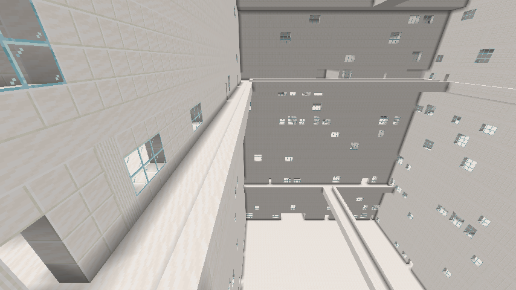
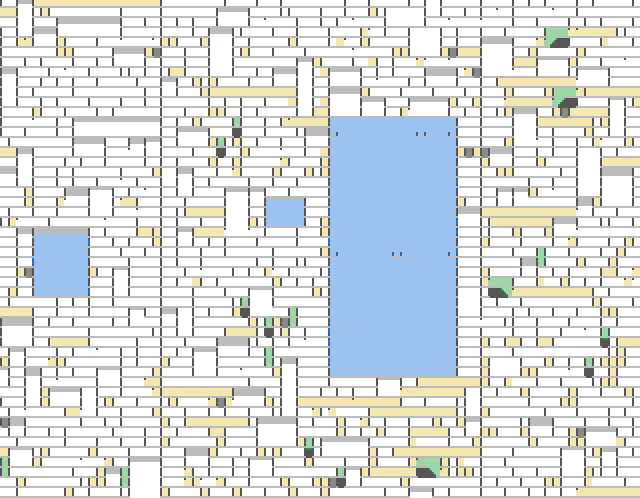
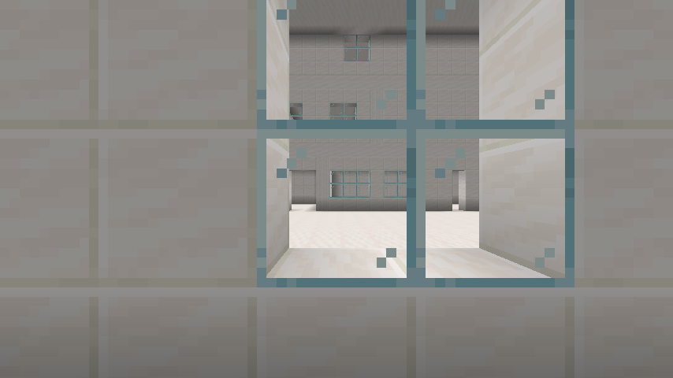
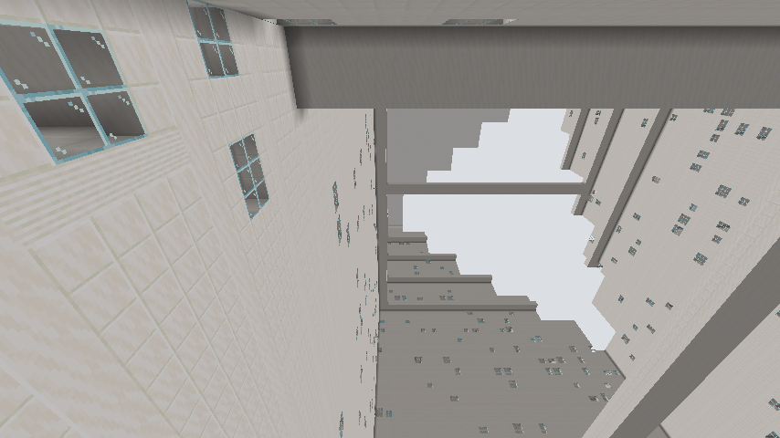
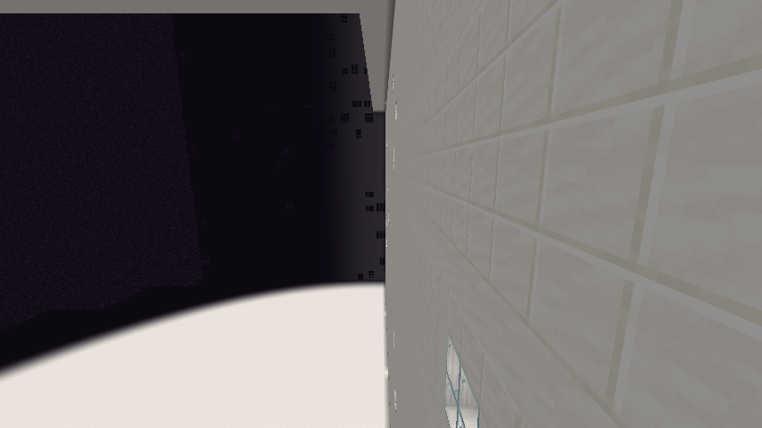
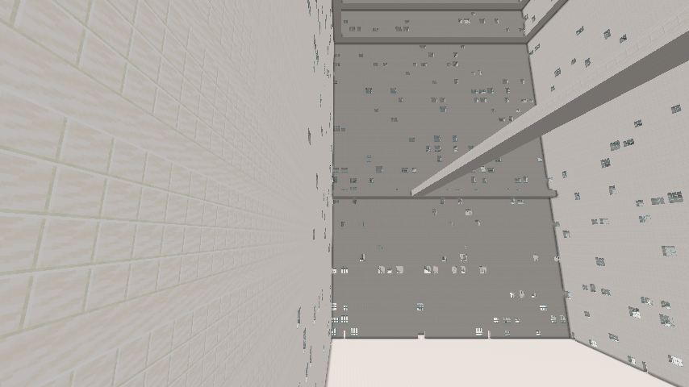

# Fenster- und Atriumsystem

## 1. Atrien

Atrien sind die architektonischen Höhepunkte: Innenräume über viele Geschosse in einer Welt, in der 90 % der Räume nur 4 Blöcke hoch sind.

### 1.1 Planung (`AtriumPlanner`)

Atrien werden **pro Region vor allen anderen Räumen vollständig geplant**: Grundfläche, unterstes Geschoss, Höhe und alle Galerieebenen. Erst danach entstehen die Geschossgrundrisse um sie herum. Damit ist die Vorgabe „Große Atrien müssen vollständig geplant werden, bevor ihre einzelnen Bereiche generiert werden“ wörtlich erfüllt.

Regeln:

| Regel | Zweck |
|---|---|
| Grundfläche mindestens 1 Einheit vom Regionsrand entfernt | Atrien reichen nie über Regionsgrenzen; ihre Wände grenzen immer an Räume derselben Region |
| unterstes Geschoss ≥ 1, oberstes ≤ Geschosszahl − 3 | über und unter jedem Atrium liegen immer normale Geschosse: **nach oben und unten geschlossen** |
| 1 Einheit horizontaler und 1 Geschoss vertikaler Abstand zu anderen Atrien | zwischen zwei Atrien liegen immer Räume, die in beide Richtungen Fenster haben können |
| Höhe ⇒ Geschosszahl ⌈(h+1)/5⌉, Rest als abgehängte Decke | beliebige Höhen trotz Geschossraster |

Atrien haben 7 Klassen (siehe [RAUMHOEHEN.md](RAUMHOEHEN.md), Abschnitt 4): kleine Lichthöfe, mittlere und große Atrien, schmale hohe **Schächte**, breite niedrige **Hallen**, riesige Atrien und seltene **Mega-Atrien** mit 96–120 Blöcken Kantenlänge und 160–300 Blöcken Höhe. Seitenverhältnisse werden zufällig gewürfelt und gedreht, Atrien sind also nicht alle quadratisch oder symmetrisch.

*Vertikalschnitt (x/y) durch Region 0,0 bei Planer-Seed 12345: das große blaue Atrium (129 Blöcke) mit Galerieebenen, daneben kleinere Atrien, Geschosse mit 4-Block-Räumen (weiß), Korridore (gelb), Treppen (grün) und hohe Räume.*

### 1.2 Galerien und Brücken

Ab einer Grundfläche von 5 × 5 Einheiten (20 × 20 Blöcke) und 3 Geschossen Höhe:

- Alle 2–4 Geschosse wird gewürfelt, ob eine **Galerieebene** entsteht (60 %).
- **Umlaufende Galerie:** ein 1 Einheit (3 Blöcke) breiter Gang entlang aller vier Wände, optional mit einer **Brücke** quer durchs Atrium (45 %).
- **Zwei gegenüberliegende Galerien mit Brücke:** nur zwei Seiten haben einen Gang, eine Brücke verbindet sie.
- Jeder Gang und jede Brücke hat eine **1,5 Blöcke hohe Brüstung** (Quarzblock + glatte Quarzstufe) zur offenen Seite.
- Galerien sind begehbare Ebenen. Räume auf diesem Geschoss können Türen auf die Galerie haben, und Fenster können auf die Galerie blicken.

Atrien selbst sind in jeder Region erreichbar über ihren Boden und ihre Galerien, sofern dort Türen geplant wurden. Ein Atrium ohne Tür ist trotzdem kein Fehler: Es bleibt als Blickziel bestehen und wird nie gefüllt.

### 1.3 Abschluss nach oben

Über dem obersten Atriumgeschoss liegt die Decke des nächsten Geschosses. Die Zellen dort gehören zwingend zu einem anderen Raum, also ist der Boden dort massiv. Bei Atrien, deren Höhe nicht genau aufs Raster passt, kommt eine abgehängte Decke dazu. Der Verifikator prüft auf Blockebene, dass nirgends Luft in Abschlussdecke und Bauhöhengrenze liegt.

## 2. Fenster

### 2.1 Regel

> Fenster entstehen **ausschließlich** auf Zellkanten, deren eine Seite ein **Atrium** und deren andere Seite ein **erreichbarer Raum oder Korridor** in dessen Bodengeschoss ist.

Diese Regel wird **bei der Planung** angewendet, nicht nachträglich korrigiert (`WindowPlanner`):

1. Kandidaten sind nur Kanten zwischen einer Atriumzelle und einer Raumzelle **im selben Geschoss**. Weil das Atrium in allen Geschossen zwischen Boden und Decke vorab reserviert ist, liegt hinter dem Fenster garantiert Atrium-Innenraum.
2. Das Fenster muss vollständig unter der Decke des Raums **und** unter der (ggf. abgehängten) Decke des Atriums liegen.
3. Die Kante trägt keine Tür.
4. Pro Raum mit Atriumkontakt: 60 % Wahrscheinlichkeit für Fenster, dann 1–2 Fenster an zufälligen Kanten. Nicht jede Wand und nicht jeder angrenzende Raum bekommt Fenster.

Daraus folgt:

- keine Fenster zwischen normalen Räumen oder Korridoren (dort gibt es keine Kandidaten),
- keine Fenster nach außen, in den Void oder in den Himmel: Atrien liegen nie am Regionsrand oder an der Welt-Ober- und Unterkante, und Fensterkanten auf Regionsgrenzen gibt es nicht,
- keine Fenster in versiegelte oder massive Bereiche.

### 2.2 Größen und Lage

Größen (Breite × Höhe): **2 × 2, 2 × 3, 3 × 2, 3 × 3**, gleichverteilt. Die Brüstung liegt 1 Block über dem Boden, die Fensterzeilen also auf Laufebene +1 bis +2 (bzw. +3). Seitlich sitzt das Fenster zufällig in der 3 Blöcke breiten Kante. Weil in 4-Block-Räumen das 3 hohe Fenster bis unter die Decke reicht, wirken die Fenster wie gewöhnliche Bürofenster, nicht wie Glasfassaden. Material: normales Glas.

### 2.3 Was man durch das Fenster sieht

Weil viele Räume rund um ein Atrium Fenster haben, sieht man auf der Gegenseite weitere kleine Fenster auf verschiedenen Höhen, dazu Galerien, Brücken und den Atriumboden weit unten.

## 3. Hintergrund und Sichtweite

Ein Fenster zeigt nie direkt in den Dimensionshintergrund, denn hinter jedem Fenster liegt Architektur. Minecraft zeichnet aber nur, was innerhalb der Sichtweite liegt und bereits geladen ist. In einem 120 Blöcke breiten Mega-Atrium und bei kleiner Sichtweite fehlt daher die Gegenseite optisch.

Im Spieltest mit den Vanilla-End-Effekten (0.0.1) war dieser Bereich **schwarz**:

Seit 0.1.0 registriert der Client eigene Dimensionseffekte (`OfficeRoomsSkyEffects`):

- **kein Himmel**, keine Sterne, keine Wolken,
- **heller, neutraler Dunst** (RGB 219/222/227) als Hintergrund- und Nebelfarbe,
- normale gerichtete Flächenschattierung (Decke dunkler als Boden), damit weiße Flächen unterscheidbar bleiben.

Was außerhalb der Sichtweite liegt oder noch nicht geladen ist, verschwindet nun in weißgrauem Dunst wie eine ferne, diesige Halle. Mit ausreichender Sichtweite (≥ 10 Chunks) ist die Gegenseite vollständig sichtbar:

## 4. Verifikation

`PlanVerifier` prüft jeden Glasblock: Er sitzt auf einer Wandlinie, die Nachbarblöcke auf beiden Seiten sind Luft, und die Planung ordnet die eine Seite einem Atrium und die andere einem erreichbaren Raum zu. Ergebnisse:

| Test | Glasblöcke | Fehler |
|---|---|---|
| Unit-Tests, 3 Seeds × 144 × 144 × 1024 Blöcke über eine Vier-Regionen-Ecke | 8 505 | 0 |
| Unit-Test, ganze Region 1,1 (26 Mio. Blöcke) | 4 670 | 0 |
| Dev-Server, 13 × 13 Chunks, echte Weltblöcke | 6 729 | 0 |
| Produktionsserver (Forge-Installation, reobf-JAR), 7 × 7 + 5 × 5 Chunks | 1 655 | 0 |
