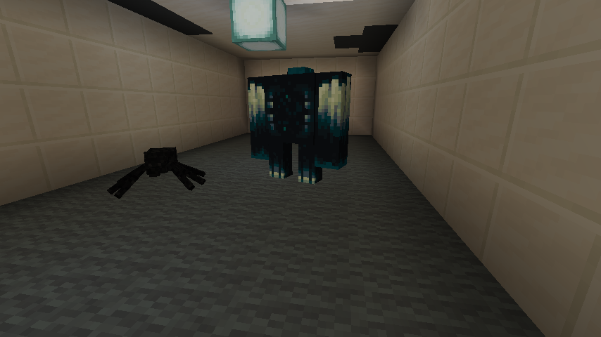

# Kreaturen und Audio (Phase 3)

> **Stand 0.3.0.** Seit 0.4.0 (siehe [PHASE4.md](PHASE4.md)): Wolfspider 1 pro 40 Räume, freundliche Variante, neues Warden-Modell, Glitched-Ingot-Drop, je ein dauerhafter Warden in Sculk-Räumen; keine natürlichen Spawns in Spezialräumen.

## 1. Wolfspider (`office_rooms:wolfspider`)

- Spinnenkörper (Brust, Hinterleib, 8 Beine) mit Wolfskopf (Schnauze, Ohren), eigenes Modell, eigene vollständig schwarze Textur.
- Läuft durch Räume und Durchgänge, greift Spieler an (Anspringen + Nahkampf).
- Jeder Treffer: normaler Schaden plus **Wither** (Dauer und Stufe konfigurierbar).
- Geräusch: tiefes, rückwärts abgespieltes, verzerrtes Wolfsheulen mit Glitch-Stottern, in unregelmäßigen Abständen (3 Varianten).
- Häufigkeit: im Schnitt **1 pro 20 Räume** in Spielernähe.

## 2. Headless Warden (`office_rooms:headless_warden`)

- Echtes kopfloses Modell: Körper, Rippen, Arme und Beine der Vanilla-Warden-Geometrie, ohne Kopf und Fühler, mit Halsstumpf. Eigene Animationen für Gehen, Vorbeugen bei der Jagd, Schrei und Angriff. Pulsierendes Herz (eigene Textur).
- Sehr schnell (Jagdgeschwindigkeit = Grundtempo × 1,6), sehr hoher Schaden (Standard 30).
- **Blind.** Er hat keine Sicht-Zielauswahl und erkennt Spieler nur über Geräusche.
- Viel seltener als die Wolfspider: im Schnitt 1 pro 1500 Räume, höchstens 1 gleichzeitig pro Spieler.
- Beim Jagdbeginn: lauter, verzerrter Glitch-Schrei. In der Nähe: Herzschlag, der mit sinkender Entfernung lauter und schneller wird (bei der Jagd noch schneller).

### Geräusch-KI

Quelle sind die Vanilla-`GameEvent`s (über Forges `VanillaGameEvent`) plus ein eigenes Sprungereignis. Es werden keine Sculk-Blöcke und keine Vanilla-Vibrationsmechanik verwendet.

| Aktion | Hörweite (Blöcke) |
|---|---|
| Gehen | 10 |
| Rennen | 18 |
| Springen | 12 |
| Landen | 14 |
| Tür/Falltür öffnen oder schließen | 18 |
| Block abbauen / setzen | 20 / 14 |
| Container öffnen/schließen | 14 |
| Treffer | 16 |
| Geschoss abfeuern | 22 |
| Explosion | 64 |

Alle Hörweiten werden mit `hearingMultiplier` multipliziert.

- **Schleichen:** Schritte, Landen und andere Ereignisse aus dem Vanilla-Tag `ignore_vibrations_sneaking` sind lautlos. Andere Geräusche zählen beim Schleichen mit halber Reichweite.
- **Durch Wände:** Es gibt keine Verdeckungsprüfung. Der Warden hört durch Wände und Decken.
- **Ablauf:**
  1. Ein gehörtes Geräusch macht den Ort zum Ziel. Der Warden läuft dorthin (Untersuchen).
  2. Ist der Spieler beim Geräusch höchstens 5 Blöcke vom Warden entfernt, beginnt die Jagd mit Schrei.
  3. Während der Jagd hält jedes weitere Geräusch des Spielers die Jagd aufrecht.
  4. Nach `forgetSeconds` Stille verliert er das Ziel.
- Es zählen nur Geräusche von Spielern (und ihren Geschossen). Spieler im Kreativ- und Zuschauermodus werden ignoriert.

## 3. Spawns

- Natürliches Spawnen läuft alle 3 Sekunden pro Spieler über den Raumplan.
  - **Wolfspider:** Räume im Umkreis von 48 Blöcken und ±2 Geschossen.
  - **Headless Warden:** Räume im Umkreis von 64 Blöcken und ±4 Geschossen.
- Zielwert = Anzahl Räume ÷ `roomsPerMob`.
- Spawnpunkt ist immer eine Zellenmitte auf dem Teppich eines geplanten Raums. Geprüft wird, dass die Hitbox frei ist (keine Wand, kein Möbel) und darunter fester Boden liegt.
- Mindestabstand zum Spieler: Wolfspider 20 Blöcke (`minDistance`), Warden 32 Blöcke.
- Kreaturen mehr als 96 Blöcke von jedem Spieler entfernt werden entfernt.
- Kein Vanilla-Spawn: Das Biom hat keine Spawnlisten.

## 4. Konfiguration

`config/office_rooms-common.toml`:

| Abschnitt | Schlüssel | Standard |
|---|---|---|
| spawning | `enabled`, `wolfspiderRoomsPerMob`, `wardenRoomsPerMob`, `wardenMaxNearPlayer`, `minDistance` | true, 20, 1500, 1, 20 |
| wolfspider | `health`, `damage`, `speed`, `witherSeconds`, `witherLevel` | 20, 4, 0.32, 6, 0 (= Wither I) |
| headless_warden | `health`, `damage`, `speed`, `chaseMultiplier`, `hearingMultiplier`, `forgetSeconds` | 160, 30, 0.42, 1.6, 1.0, 4 |

`config/office_rooms-client.toml` (Abschnitt `audio`): `lampHumVolume` (0,35), `heartbeatVolume` (1,0), `heartbeatRange` (40).

Werte für Leben, Schaden und Tempo wirken auf neu gespawnte und neu geladene Kreaturen. `/officerooms spawning true|false` schaltet das Spawnen ohne Neustart.

## 5. Musik und Ambient

- **Musik:** ausschließlich die bereitgestellte Aufnahme `officerooms.mp3`. Sie wurde nur nach Ogg Vorbis umgewandelt (Stereo, 44,1 kHz, 7:45), mit je 30 ms Ein- und Ausblendung gegen Knacken an der Loop-Stelle.
  - Läuft als eigene Endlosschleife (Kategorie „Musik“, gestreamt), nur in der Dimension.
  - Die Vanilla-Musik ist dort unterdrückt.
  - Beim Verlassen stoppt sie. Beim Wechsel von Chunk oder Geschoss startet sie nicht neu.
- **Lampensummen:** eine zentrale, sehr leise Endlosschleife (100 Hz mit Obertönen, 12 s, nahtlos). Sie läuft in der ganzen Dimension, Kategorie „Umgebung“. Die Lautstärke folgt leicht der Blockhelligkeit am Spieler.

## 6. Bekannte Einschränkungen

- Keine Verdeckung: Wände dämpfen nichts. Das ist gewollt („durch Wände“), macht den Warden aber sehr scharf.
- Geräusche von Nicht-Spielern (Kreaturen, Redstone) lösen nichts aus.
- Das Warden-Modell nutzt die Textur des installierten Minecraft. Ressourcenpakete, die die Warden-Textur ändern, ändern auch den Headless Warden.
- Der Herzschlag ist ein Client-Effekt. Er gehört zum nächsten Warden in Reichweite, auch ohne Sichtlinie.
