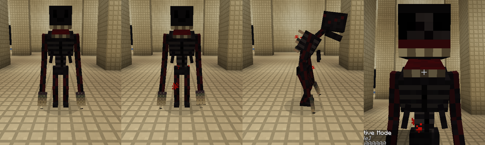

# Office Rooms 0.10.0 (beta) – GeckoLib and the new Gaunt

## New required dependency: GeckoLib

Office Rooms now needs **GeckoLib for Forge 1.20.1 (4.4 or newer, tested with 4.8.4)** on the server and on every client. Download it from CurseForge or Modrinth and put it into the `mods` folder next to Office Rooms. It is not bundled.

GeckoLib lets creatures have many bones and keyframe animations instead of simple box models.

## The Gaunt, redesigned

First creature in the new style (dark, wrong anatomy, unnatural movement). Mechanics are unchanged.

- Hunched, emaciated body with a visible rib cage, spine spikes and a glowing heart; a long neck and a pallid skull with deep, uneven eye sockets, glowing pupils and long uneven teeth on a separate jaw.
- Floor-length arms in two segments with bone claws, two small vestigial arms on the chest, legs that bend the wrong way.
- Animations: idle (slow breathing, the skull snaps sideways in sudden jerks, claws curl, the small arms twitch), a lurching walk, a fast run thrown forward with the jaw open and the head shaking, and a scream (rears up, jaw unhinged, arms spread, whole body shaking) when it calls its pack.
- Eyes and heart glow in the dark.

Model, animations and textures are generated by `tools/gen_gaunt_geo.py` (no foreign assets).

## Tests (actually run)

- Build OK, 16 unit tests, 0 failures.
- Production server and client with GeckoLib 4.8.4, OfficeCraft and Refurbished: no errors from GeckoLib or Office Rooms.
- Gaunt seen from front, side and three-quarter view; idle twitch and the scream pose captured; a Gaunt summoned 18 blocks away reached the player within about 2 seconds (chase AI unchanged).

## Not tested

- Shader packs with the GeckoLib model, multiplayer.
