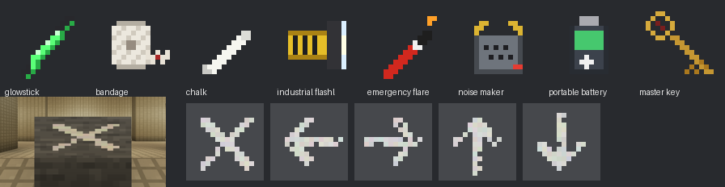

# Office Rooms 0.10.1 (beta) – QoL tools

Eight small tools to find in the Office Rooms. Requires GeckoLib like 0.10.0. Everything else is unchanged.

| Item | What it does | Where |
|---|---|---|
| **Glowstick** | Throw it: a dim green light (level 12) with a soft glow where it lands, for about a minute. Stacks to 16. | Office loot (supplies, common) |
| **Bandage** | Takes 2 seconds to apply (you move slowly and cannot run meanwhile), then Regeneration I for 12 s (about 2.5 hearts). Only usable when hurt. | Office loot; craftable: 2 paper + white wool → 3 |
| **Chalk** | Right-click a wall: click its left, right, top or bottom part for an arrow in that direction, the middle for a cross. 64 marks. Marks need a solid wall behind them. | Office loot |
| **Industrial Flashlight** | Right-click to switch on: a bright beam (light 15) where you point, up to 28 blocks, and light right in front of you. About 2.8 minutes of charge. A Smiler treats a lit flashlight like a torch. | Rare office loot only |
| **Emergency Flare** | Throw it: blinding red light with flames and smoke for 20 s. Creatures within ~9 blocks back away from it (not the Hunter and not the blind Headless Warden). | Office loot only |
| **Noise Maker** | Throw it: rings for 10 s; creatures within 24 blocks drop their target and go to the noise (not the Hunter). | Office loot only |
| **Portable Battery** | Hold a flashlight in the other hand and right-click: the flashlight is fully charged. 3 charges. Empty? Right-click a lit ceiling light: the battery is full again, but that light goes dark for good. | Office loot only |
| **Master Key** | Opens every security door (all levels). Wears out after 3 doors. | Extremely rare: special-room loot, maze vault (8 %), level 3 secure storage (6 %), Poolrooms vault (3 %) |

Loot: the new table `tiers/tools` holds glowsticks, bandages, chalk, flares, noise makers, batteries and flashlights; it is linked from the supplies, common, uncommon and rare tiers. The lights of glowsticks, flashlights and flares are invisible temporary blocks that remove themselves.

## Tests (actually run)

- Build OK, 16 unit tests, 0 failures. No exceptions in the server log.
- In game (production server and client, GeckoLib 4.8.4):
  - Glowstick thrown: one light block where it landed.
  - Flashlight switched on: light blocks along the beam.
  - Chalk on a wall, middle: cross mark, chalk wear 1.
  - Bandage while hurt: Regeneration applied, one bandage used; refused at full health.
  - Battery with a half-empty flashlight in the off hand: flashlight back to full, battery down one charge.
  - Master key on a closed level 3 door: door opens, key wear 1.
  - Flare thrown next to a Hound 3.5 blocks away: the Hound moved to 10 blocks away within 4 s.
  - Noise maker thrown 20 blocks from a Hound: the Hound walked to the noise.

## Not tested

- Drawing over an existing chalk mark to change it (the test click missed the wall).
- Arrow marks (only the cross was tested in game), recharging the battery from a ceiling light, the flashlight running empty, multiplayer, shader packs.
