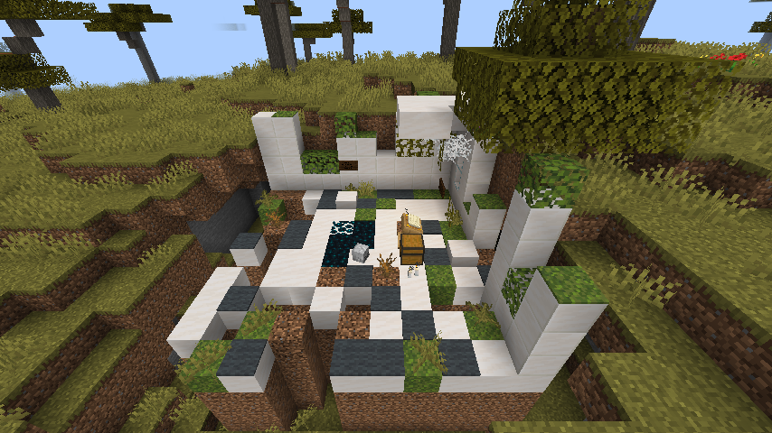
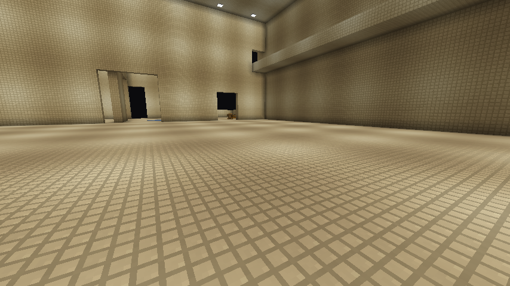
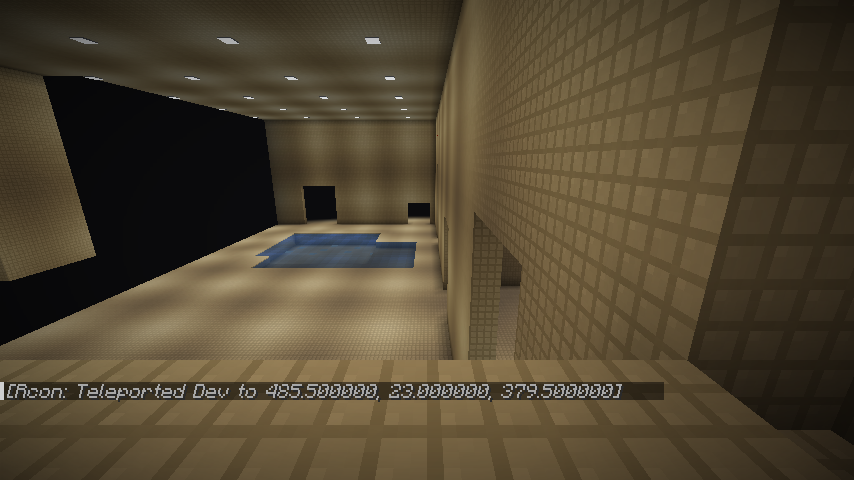
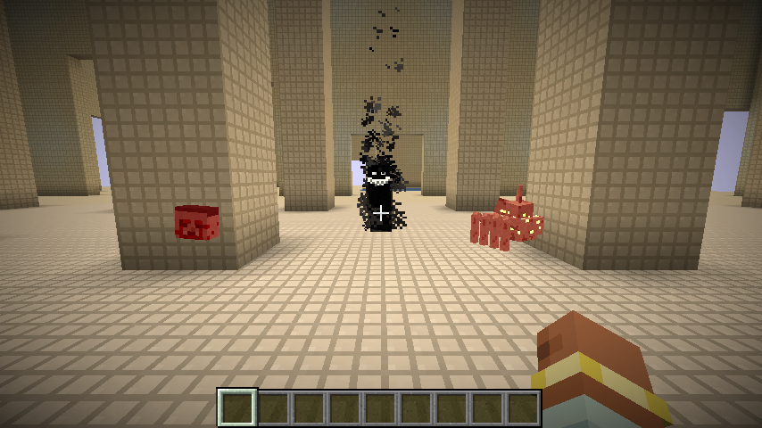
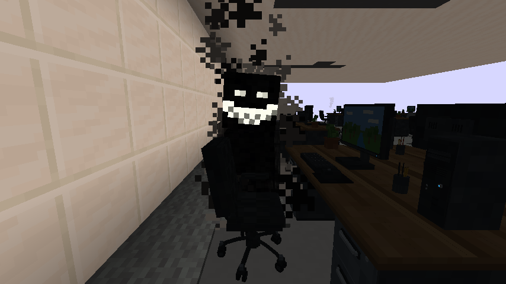
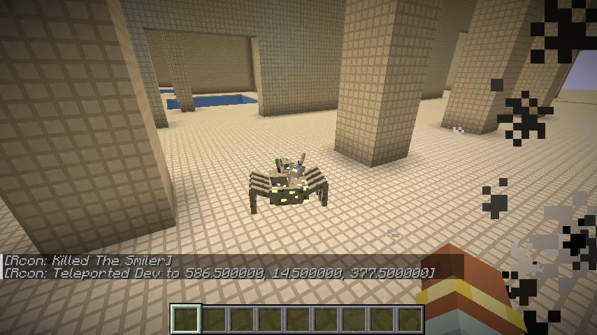

# Office Rooms 0.6.0 – Shrines, Poolrooms and new entities

Everything from earlier versions is still in the mod. This update only adds new content.

## Install (short)

1. Forge 1.20.1-47.4.28, Java 17.
2. Put `OfficeRooms-0.6.0.jar` into `mods/` on the server **and** every client. Optional (recommended): OfficeCraft 1.0.3 and Refurbished Furniture 1.0.20 (+ Framework), downloaded from their official pages.
3. Create a new world (or explore new chunks). The shrine and the Poolrooms only generate in chunks that did not exist before.
4. Updating from 0.5.0: the config file `office_rooms-common.toml` gets the new sections `[hound]`, `[smiler]` and `[colony]` added automatically.

## 1. Abandoned Office Shrine (Overworld, very rare)

- **What it is:** a fragment of the Office Rooms lying half-buried and overgrown in the Overworld.
  - broken quartz walls, a corner pillar and a piece of ceiling with a dead light panel
  - grey carpet, moss, vines, cobwebs and creeping sculk
  - fallen ceiling slabs and debris scattered around it
- **The shrine:**
  - a lectern with a survivor's warning book
  - candles and a skull
  - a chest with **everything needed to open the portal**: a sculk sensor, sand, another warning book and a few supplies
- **Warning signs:** "Those who dare will never leave." and "Do not combine them. You won't survive."
- **Where:** only on dry, fairly flat ground in plains, meadows, forests, taiga, savanna, swamp and cherry groves.
  - It keeps its distance from villages.
  - Placement grid: 48 chunks spacing, 20 chunks separation.
  - Find one with `/locate structure office_rooms:abandoned_office_shrine`.

## 2. The Poolrooms (Office Rooms, extremely rare)

- **Where:** in about 1.2 % of regions (`poolrooms_region_chance`), five storeys (25 blocks) of the office building are replaced by a gigantic indoor pool complex covering the whole region (160 × 160 blocks).
- **Look:** cream tiled walls, floors and ceilings (new Pool Tile blocks), bright and evenly lit, completely empty.
- **Halls and corridors:**
  - huge halls linked by tiled arches
  - pillar halls and flooded halls
  - long, low corridors, some with a water channel
- **Water:** pools of different sizes and depths (1–3 blocks) with glowing tiles in the deeper ones.
- **Gallery:** an upper level runs around the whole complex, with railings and staircases.
- **Way in:** office doors on two storey levels lead straight in.
- **Hidden underwater labyrinth:**
  - The entrance is a tiny 1 × 2 pool in a corner of a dim hall, easy to overlook.
  - Below it is a flooded maze of tiled corridors with occasional sea lanterns and a few air pockets in the ceiling.
  - At the far end of the path are two treasure chests: diamonds, emeralds, gold, Heart of the Sea, trident, enchanted books, golden apples, a conduit, netherite scrap and more.
- **Also found:** lifeguard corners with a chest and sometimes a lectern with a Poolrooms logbook.
- **Ambient sounds of its own:** water lapping, distant splashes, echoing drips, the hum of a pool pump and rare distant calls.
- **Commands:** `/officerooms goto poolrooms` and `/officerooms goto poolrooms_maze`.

## 3. New entities (whole Office Rooms dimension, uncommon)

| Entity | Look | Behaviour |
|---|---|---|
| **The Hound** | Gaunt wolf body with a bloody human head | Aggressive, very high damage (12; kills in 2 hits on Normal). **Hold Mushroom Stew** (either hand) and it will not attack you: it stops mid-attack, sniffs and walks away, even if you hit it. Spawns anywhere in the dimension, at most one near you; on average one shows up every few minutes of exploring. |
| **The Smiler** | A tall veil of shadow and smoke, only a glowing smile and two eyes | Spawns only in dark spots (block light ≤ 3). Stalks slowly, faster when you look away. It giggles. Touching it kills instantly. If it gets stuck it reappears in the dark behind you. **Hold a torch and point it straight at it** (within 10 blocks, clear line of sight) and it dissolves. Bright light drives it off too. Ordinary weapons do not hurt it. |
| **The Colony** | An original creature: a crawling, many-legged mass of pale, diseased growth with glowing spots | Extremely rare (roughly one encounter per 20 minutes of exploring, never more than one near you). Screams when it picks up your trail and hunts you without needing to see you. It is faster than a walking player but slower than a sprinting one (about 4.6 blocks/s) and deals 14 damage (vanilla difficulty scaling applies). **After about 10 seconds of continuous pursuit it falters**: it shakes and nearly stops for 3 seconds. That is your chance to get away. |

All three also spawn inside the Poolrooms. Settings are in `office_rooms-common.toml`, sections `[hound]`, `[smiler]` and `[colony]` (health, damage, speed, `spawnChance`, `maxNearPlayer`, Colony chase and falter seconds, Smiler max light). Spawn eggs are in the creative tab.

## 4. Books

New English books:
- three warning books for the shrine
- two Poolrooms logbooks
- four survivor notes that hint at the Hound (mushroom stew), the Smiler (torch), the Colony (it falters after ten seconds) and the Poolrooms

## New blocks and crafting

Pool Tile, Pool Floor Tile, Pool Tile Stairs and Pool Tile Slab. Mine them in the Poolrooms with a pickaxe (they drop themselves).

| Result | Recipe |
|---|---|
| 4 Pool Tile Stairs | 6 Pool Tile in a stair shape (crafting table) |
| 6 Pool Tile Slabs | 3 Pool Tile in a row |
| 1 Pool Tile Stairs / 2 Pool Tile Slabs | 1 Pool Tile in the stonecutter |
| Pool Floor Tile ↔ Pool Tile | 1:1 in the stonecutter |

Opening the portal is unchanged from 0.5.0: drop sand onto a sculk sensor to tear open a Liminal Rift. The shrine chest contains both.

## Performance

- Regions without Poolrooms are rejected by a cheap hash check before any cache is touched.
- The internal plan caches now spread neighbouring regions across hash buckets (this also speeds up the older parts of the generator slightly).
- The new mobs are only spawned near players, capped per player and despawn beyond 96 blocks like the other Office Rooms mobs.
- Measured on a 2-core test machine, server only: fresh-chunk generation of 49 chunks took about the same time as 0.5.0 (0.5.0: 6.8–8.2 s, 0.6.0: 7.2–7.9 s).

## Screenshots

| | |
|---|---|
|  Abandoned Office Shrine |  Poolrooms hall with gallery |
|  Pool with glowing tiles |  Hound, Smiler and Colony (spawned for the picture) |
|  The Smiler in an office |  The Colony |
