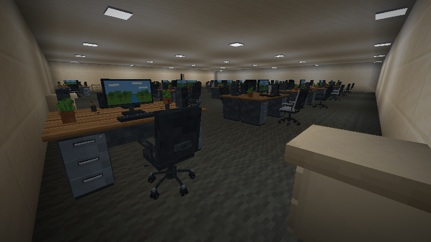
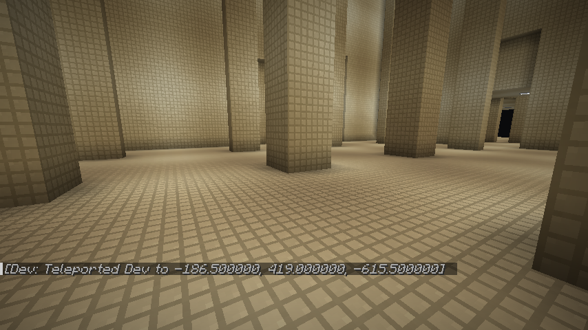

# Office Rooms 0.6.1 – Wool floors, lower building, crash fix

**Important: start a new world (or delete the folder `dimensions/office_rooms/office_rooms` inside an old world's save).** The building grid and the dimension height changed. Chunks generated by 0.6.0 or older would no longer line up with new ones, and everything above Y 543 in an old world is cut off.

- **Grey wool floors instead of carpet.** Every storey slab is now two blocks thick: smooth quartz underneath (the ceiling of the room below, unchanged) and grey wool on top (the floor). No more carpet layer, so no more seams between carpet and ceiling and no more mobs stepping on 1/16-block carpets. Walls, ceilings and every edge seen from an atrium stay quartz; wool only appears where you can walk. Rooms are still 4 blocks tall, furniture, doors, windows, atriums and special rooms are unchanged. Stairs got one more step.
- **Lower building for better performance.** The dimension is now 608 blocks tall (Y −64 to 543, 60 % of before) with 101 storeys (previously 204).
- **Poolrooms** adapted to the new storey grid (hall and gallery still connect to the office doors).
- **Crash fix:** leaving a world could crash with "Entity is already tracked!" when falling sand was unloaded near the portal code. The portal check now only reacts to sand that actually lands.
- Office doors on the edge of the Poolrooms that open onto the tile ring are intended (a doorway filled with pool tiles); the world check no longer reports them as errors.

**Shaders:** OfficeCraft draws its furniture with its own renderer. With Oculus/Iris shader packs (for example BSL) active, that furniture can turn invisible (only outlines) and FPS drop sharply. Turn the shader pack off (Oculus: `K`, or Video Settings → Shader Packs) while you are in the Office Rooms.

## Screenshots

