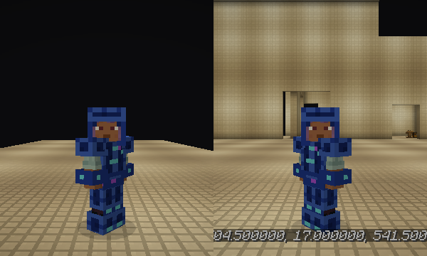

# Office Rooms 0.7.1 – Shaped armor, everything in English

Works with 0.6.1+ worlds.

## Multidimensional armor with a real shape

The armor used to cover every face of the player model like a box, including the face. It is now drawn like vanilla armor, with open areas:

- **Helmet:** Netherite-style silhouette – brow band, cheek and jaw guards, open face, crest on top.
- **Chestplate:** chest plate with a centre ridge, shoulder plates and bracers; upper arms and lower belly stay visible.
- **Leggings:** belt with buckle, thigh plates and knee guards.
- **Boots:** only around the feet, with cuffs and toe caps.

Own drawing in the existing Multidimensional colours (`tools/gen_armor_070.py`). Stats and recipes are unchanged.

## Everything in English

- All command output (`info`, `stats`, `goto`, `mobs`, `spawning`, `verify` and its error messages, `furniture`), arrival and window messages.
- Config file comments in `office_rooms-common.toml` / `office_rooms-client.toml` – existing files are updated automatically on the next start.
- Log messages, the `enter`/`leave` functions, the mod description.
- The German language file (`de_de`) now shows the same English texts, so players with a German game language see English too.
- README, FEATURES and BUILD_INSTRUCTIONS are in English. The older design notes of versions 0.1–0.4 in `docs/` and `ARCHITECTURE.md` are still in German.

Note for scripts: `/officerooms verify` now ends with `RESULT: OK` or `RESULT: ERRORS`.
