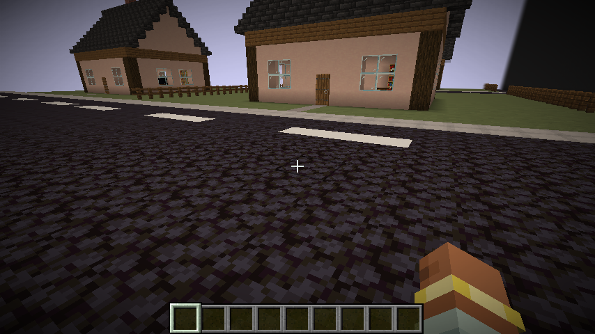
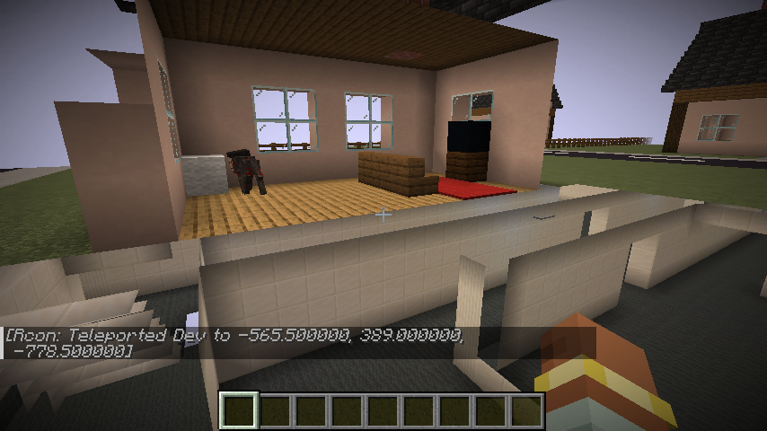
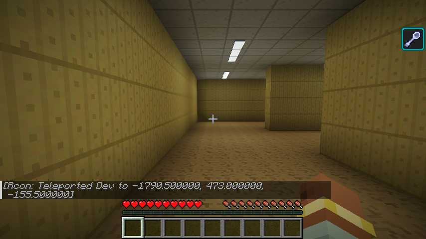
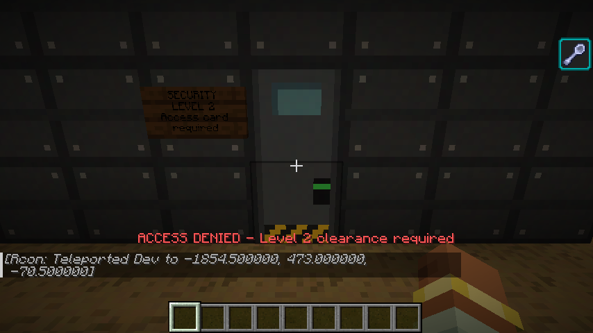
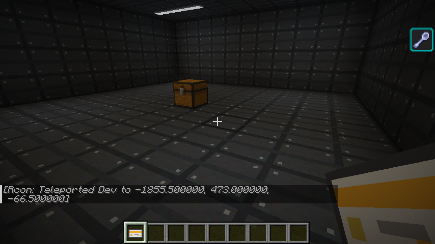

# Office Rooms 0.8.0 (beta) – The Neighbourhood, The Maze and new tools

Works with 0.6.1+ worlds. The new megastructures only appear in newly generated chunks. Everything from earlier versions is unchanged unless listed here.

## Two new megastructures

Each region (160 × 160 blocks) holds at most one megastructure. The Poolrooms keep their placement from 0.6.0. Regions without Poolrooms roll once more: with the same chance as the Poolrooms (`poolrooms_region_chance`, default 0.012) they become a Neighbourhood, with the same chance again they become The Maze. All three megastructures are therefore equally rare (unit test on 3600 regions: Poolrooms 54, Neighbourhood 56, Maze 48).

Both bands sit somewhere between storey 8 and the upper storeys, never in the dark exit storeys. Teleport: `/officerooms goto neighbourhood`, `goto maze`, `goto maze_vault`.

### The Neighbourhood

- A huge hall, 4 storeys tall, **without any light**. You need torches, or night vision.
- 20 identical suburban houses on identical lots in 4 rows of 5: asphalt streets with lane marks, sidewalks, lawns, fences, gravel paths. Every house is the same: white walls, dark oak corners, windows, a spruce door, a gable roof of deepslate tiles with a brick chimney, an attic, and the same furniture inside (bookshelf, TV, sofa, carpet, side table, a dead plant).
- **Every third house** (houses 3, 6, 9, 12, 15, 18) has a resident: a Smiler (35 %), Hound (35 %), Headless Warden (20 %) or even a Colony (10 %). Residents are persistent and wait inside.
- **Every other house** has a chest (`chests/neighbourhood_house`): office supplies, food, almond water, stories, sometimes diamonds or netherite scrap, an Anomaly Detector (~10 %) or an access card (~4 %).
- Up to 3 creatures (Wolfspider, Hound, Smiler) roam the streets around you.
- You get in through the doors of the neighbouring offices on the entrance storey; the hall is closed off by a thick concrete ring wall.

### The Maze (Level 0)

- One storey: yellow wallpaper, damp carpet, acoustic ceiling tiles and buzzing fluorescent strips (about one in eight is dead). 26 × 26 cells of corridors with loops and several open halls full of pillars.
- **Mining Fatigue III** as long as you are inside. Digging your way out is not an option.
- **3–5 exits** lead back into the office rooms: openings through the west and north office wall into ordinary rooms or corridors of the neighbouring region. They are only 3 blocks tall, so the Hunter cannot follow.
- **The Hunter** is always there (exactly one), plus Wolfspiders, Hounds, Smilers, Gaunts and rarely a Headless Warden (up to 5 near you).
- **Security vault:** a hidden room of unbreakable steel plates (walls, floor and ceiling) with a **Security Door**. The sign next to it shows the level: 1 (60 %), 2 (30 %) or 3 (10 %). Inside is one chest with the rarest loot in the game: always Multidimensional gear (often two pieces), Totem of Mercy (~35 %), an effect sword (~60 %), The Temporal Watch (~25–30 %), a Level 3 Access Card (~12–15 %), netherite ingots, enchanted golden apples, Glitched Ingots, Multidimensional Rods, enchanted books and diamonds.

## New items

| Item | What it does | Where |
|---|---|---|
| **The Temporal Watch** | Right-click: every creature within 8 blocks gets Slowness VI and Weakness II for 4 seconds (almost frozen). Cooldown 2 minutes. | Only the rare office loot tier (~4 % of rare rolls), the maze vault |
| **Anomaly Detector** | Hold it (main or off hand): the action bar shows a signal bar and percentage, and it beeps faster and higher the closer the nearest creature is (range 32 blocks). It never says which creature it is. | Uncommon loot tier, Neighbourhood houses |
| **Level 1 / 2 / 3 Access Card** | Opens Security Doors up to its level (main or off hand, right-click the door). Currently the only security door is the maze vault. | Very rare in special-room loot (L1, L2), Neighbourhood houses (L1, L2), Poolrooms vault (L2, L3), maze vault (L3) |

## New blocks

- **Maze Wallpaper**, **Damp Carpet**, **Maze Ceiling Tile**: can be mined and used for building (creative tab).
- **Security Wall** and **Security Door**: unbreakable, immovable, no drop. The door ignores redstone and stays open until you close it with the card again.

## Config

No new options. `poolrooms_region_chance` in the generator settings now controls all three megastructures. A new loot entry `neighbourhood_house` is added to `office_rooms-common.toml` `[loot]` automatically.
