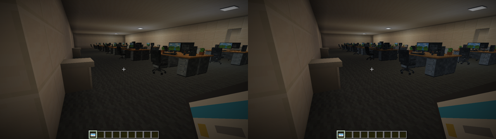
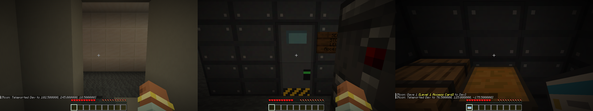

# Office Rooms 0.9.0 (beta) – Elevators, hints, flickering lights, secure storage, faster shader furniture

Works with 0.8.x worlds. Elevators and secure storage rooms only appear in newly generated chunks. Everything else is unchanged.

## Faster OfficeCraft furniture with shader packs

The compatibility renderer now draws simplified shapes at a distance. The largest triangles of a mesh carry almost all of its visible surface; the thousands of tiny ones are rounded edges and screws. Kept are 90 % of the surface (about one eighth of the triangles) at medium range and 70 % far away. Screens and lamps stay complete.

Client config `office_rooms-client.toml`, section `[compat]`:

| Option | Default | Meaning |
|---|---|---|
| `officeCraftShaderDetail` | `BALANCED` | `FULL` = every triangle (as in 0.8), `BALANCED` = full detail only close to the camera, `SIMPLE` = always simplified (fastest) |
| `officeCraftShaderFullDetailDistance` | 8 | BALANCED: full detail within this many blocks |
| `officeCraftShaderRenderDistance` | 48 | furniture further away is not drawn |
| `officeCraftShaderShadows` | false | furniture casts no shadows with shader packs (the shadow pass drew everything a second time) |

If it is still too slow: set `SIMPLE` and lower the render distance to 32. Drawing the furniture "without shaders" while a shader pack is active is not possible, that is exactly the path that made it invisible.

## Megastructure hints

Up to 8 storeys above and below a megastructure its sounds seep through the floors: lapping water (Poolrooms), buzzing neon (The Maze), distant barking (Neighbourhood). Louder and more frequent the closer you are, and it comes from above or below, wherever the structure is. Config `[atmosphere] megastructureHints`, `megastructureHintStoreys`.

## Elevators

- Every region without a megastructure has one elevator shaft: a light grey 5 × 5 column with a 3 × 3 cabin, at the same spot on all storeys. A storey is a stop wherever a side opens onto an ordinary room or corridor (on average 97 of 101 storeys).
- Stand on the **Elevator Plate** and **jump** to ride up, **sneak** to ride down. **Right-click** the plate to choose 1, 5, 10 or 25 floors per ride. The action bar shows the floor.
- The plate is also craftable (iron, piston, ender pearl, redstone → 2) and works anywhere between plates stacked above each other (up to 64 blocks apart).
- Find one: `/officerooms locate elevator`.

## Flickering lights

Ceiling lights within 5 blocks of a creature flicker when that creature is within 14 blocks of a player. Config `[atmosphere] lightFlicker`, `lightFlickerRadius`.

## Secure storage rooms (Level Access Cards)

- Rare strongrooms of unbreakable plating inside ordinary offices (about one per two regions), closed by a security door of level 1 (60 %), 2 (30 %) or 3 (10 %), with a sign.
- Inside: a chest (`chests/secure_storage_1/2/3`, better loot per level) and a supply barrel.
- Progression: Level 1 cards are now also in rare office loot; level 1 rooms can hold a Level 2 card (20 %), level 2 rooms a Level 3 card (20 %); level 3 rooms hold Multidimensional gear and can hold a Totem of Mercy.
- Find one: `/officerooms locate secure_storage`.

## Tests (actually run)

- Build OK, 16 unit tests, 0 failures (new: elevators and storage rooms never in megastructure regions, every elevator has at least 2 stops; the block rules of the planner hold with the new installations).
- In game (production server, fresh world, seed 4711): elevator ride up 1 floor, 10 floors after two right-clicks, down by sneaking; storage door stays closed without a card and opens with a Level 1 card; chest and barrel carry the right loot tables; `verify 2` around elevator and storage: 0 errors.
- Flicker: a light above a creature was off in 39 of 120 samples, never without a creature, and lit again after the creature was gone. Dimension tick 4.1 ms.
- Shader renderer forced on without a shader pack: furniture looks the same as the original at room distance, no errors.

## Not tested

- Frame rate with a real shader pack (please report), shadows option.
- The hint sounds were not checked by ear; the server ran 70 s above a Poolrooms without errors.
- Multiplayer for the new features.
