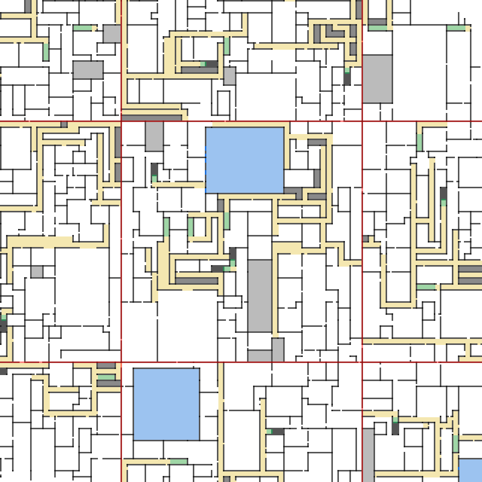

# Raumplanungssystem

Dieses Dokument beschreibt, wie Office Rooms 0.1.0 die Architektur plant und in Blöcke umsetzt.

## 1. Grundprinzip: Planung als reine Funktion der Koordinaten

Minecraft erzeugt Chunks parallel und in beliebiger Reihenfolge. Ein Chunk kann nicht auf seine Nachbarn warten. Deshalb gilt:

1. **Jede Entscheidung wird aus `hash(weltSeed, Region, …)` abgeleitet.** Es gibt keinen globalen veränderlichen Zustand.
2. **Geplant wird in Regionen, nicht in Chunks.** Eine Region ist eine senkrechte Säule von 160 × 160 Blöcken über alle 204 Geschosse. Sie wird einmal vollständig geplant, inklusive aller Atrien, Großräume und Treppen, und im Speicher gecacht.
3. **Jeder Chunk fragt nur ab.** Für jede seiner 16 × 16 × 1024 Positionen fragt er „Welcher Block gehört hierher?“ (`BlockSampler`). Weil alle Chunks dieselbe Planung abfragen, passen Großräume und Atrien über Chunkgrenzen hinweg exakt zusammen. Nichts wird doppelt gesetzt oder abgeschnitten.

Der Planer (`de.officerooms.room`, `atrium`, `window`) verwendet keine Minecraft-Klassen. Dadurch lässt er sich mit JUnit vollständig testen.

## 2. Raster

### 2.1 Horizontal

| Begriff | Größe (Standard) | Konfiguration |
|---|---|---|
| Einheit (Zelle) | 4 × 4 Blöcke | `grid.unit_size` (4–8) |
| Modul | 16 × 16 Blöcke = 4 × 4 Einheiten | ergibt sich aus `unit_size` |
| Region | 160 × 160 Blöcke = 40 × 40 Einheiten = 10 × 10 Chunks | `grid.region_units` (16–64) |

Jede Zelle hat ihre **Wandlinie auf der West- und Nordseite** (lokale Position 0), die Positionen 1–3 sind Innenraum. Wände sind dadurch immer genau 1 Block dick und gehören beiden Nachbarzellen gemeinsam.

**Gehören zwei benachbarte Zellen zum selben Raum, ist die Linie zwischen ihnen Innenraum.** So verschmelzen 2 × 2, 3 × 2, 4 × 3 … Module zu einem echten Großraum ohne Zwischenwände. Ein 16 × 16-Modul hat 15 × 15 Blöcke lichte Fläche, ein 32 × 32-Großraum 31 × 31.

### 2.2 Vertikal

| Ebene | Y |
|---|---|
| Bedrock | −64 |
| Boden Geschoss 0 | −63 |
| Boden Geschoss s | −63 + 5·s |
| Laufebene Geschoss s | −62 + 5·s |
| Boden Geschoss 203 (oberstes) | 952 |
| Abschlussdecke | 957, darüber massiv bis 959 |

Geschossraster = `base_height + 1` = 5 Blöcke (1 Block Decke/Boden + 4 Blöcke lichte Höhe). Die Zahl der Geschosse ergibt sich aus der Dimensionshöhe: (1024 − 2) / 5 = **204**. `grid.storeys` kann sie verringern.

**Das Raster schränkt die Raumhöhe nicht ein.** Ein Raum belegt so viele Geschosse, wie seine Höhe braucht. Die Blöcke zwischen gewünschter Höhe und nächster Geschossdecke werden als abgehängte Decke (glatter Quarz) gefüllt. Ein 6 Blöcke hoher Raum belegt also 2 Geschosse (9 Blöcke Platz), 3 Blöcke davon sind Decke. Details in [RAUMHOEHEN.md](RAUMHOEHEN.md).

## 3. Planungsablauf einer Region

*Grundriss eines Geschosses über 2 × 2 Regionen. Weiß: Räume, gelb: Korridore, grün: Treppenhäuser, blau: Atrien mit Fenstern (dunkelblau), grau: Wände bzw. abgehängte Decken hoher Räume aus dem Geschoss darunter, rot: Regionsgrenzen.*

`LayoutBuilder.build()` arbeitet in dieser festen Reihenfolge:

1. **Atrien** für die ganze Regionssäule (`AtriumPlanner`, siehe [FENSTER_UND_ATRIEN.md](FENSTER_UND_ATRIEN.md)). Ihre Zellen sind ab jetzt in allen Geschossen reserviert.
2. **Für jedes Geschoss von unten nach oben:**
   1. **Treppenhäuser:** 1 × 3 Einheiten, gerade Treppe über genau ein Geschoss. Sie reservieren ihre Zellen auch im Geschoss darüber. Die Zelle vor dem unteren Ende (dieses Geschoss) und vor dem oberen Ende (nächstes Geschoss) wird als „muss begehbar sein“ markiert. Ziel: 3 pro Geschoss und Region.
   2. **Korridornetze:** Sie starten an den markierten Treppenzugängen, dazu 1–3 zufällige Startpunkte. Ein Netz wächst in Segmenten (3–10 Einheiten, 12 % lange Segmente bis 24 Einheiten), biegt ab (L), verzweigt (T, Kreuzung) und bekommt seitliche Abzweige. 20 % der Segmente sind breit (2 Einheiten = 7 Blöcke). Eine Regel verhindert, dass ein Netz seitlich an sich selbst stößt. So entstehen keine Korridorklumpen. Ein ganzes Netz ist *ein* Raum: Ecken und Kreuzungen sind offen. Höchstens 30 % der Fläche sind Korridor.
   3. **Räume:** Das Raster wird zeilenweise abgetastet. An jeder freien Zelle wird eine Größenklasse gewürfelt (gewichtet), zufällig gedreht und so groß gesetzt, wie Platz ist (mindestens 2 × 2 Einheiten). Mit 15 % Wahrscheinlichkeit kommt ein Flügel dazu (L-, T- oder versetzte Grundrisse).
   4. **Raumhöhe:** Sie wird aus den Höhenbändern gewürfelt. Hohe Räume reservieren ihre Zellen in den Geschossen darüber. Ist dort kein Platz, bleibt der Raum 4 hoch, und die gewürfelte Höhe geht an den nächsten Raum weiter. So bleibt die Verteilung exakt.
   5. **Restzellen**, in die kein 2 × 2-Raum mehr passt, werden an einen angrenzenden einstöckigen Raum angehängt (Sonderformen). Sonst werden sie massiv gefüllt. Ein markierter Treppenzugang wird nie massiv, notfalls entsteht ein kleiner Vorraum.
3. **Verbindungsplanung** (`ConnectionPlanner`, Abschnitt 4).

Die Planung einer Region dauert etwa 0,6 s und belegt rund 1,4 MB. Der Cache hält 64 Grundrisse und 48 fertige Pläne.

## 4. Türen, Durchgänge und Erreichbarkeit

### 4.1 Wo eine Öffnung überhaupt möglich ist

Jede **Zellkante zwischen zwei verschiedenen Räumen** im selben Geschoss ist ein Kandidat, wenn beide Seiten dort begehbar sind:

| Raumart | Öffnung möglich … |
|---|---|
| Raum, Korridor | nur im eigenen **Bodengeschoss**. Hohe Räume bekommen nie eine Tür in halber Wandhöhe. |
| Treppenhaus | nur exakt an seinem unteren Ende (unten) und oberen Ende (oben) |
| Atrium | auf dem Atriumboden und an Galerie- und Brückenzellen der Galeriegeschosse |
| massiv / versiegelt | nie |

Damit liegt hinter jeder Öffnung auf **beiden** Seiten Laufebene. Eine Tür ins Leere oder in eine Wand ist schon bei der Planung ausgeschlossen. Türpositionen liegen immer innerhalb einer Kante (Positionen 1–3), nie auf einem Wandknoten, an den eine Querwand anschließen könnte.

### 4.2 Auswahl

Aus allen Kandidaten entsteht ein Graph (Knoten = Räume, Korridornetze, Treppenhäuser, Atriumebenen):

1. **Treppenanschlüsse sind Pflicht.**
2. **Spannbaum (Kruskal)** über zufällige Gewichte. Korridor–Korridor-Kanten wiegen ×0,2, Korridor–Raum ×0,35, Atrium ×0,5, Raum–Raum ×1,0. Räume hängen dadurch bevorzugt an Korridoren, wie in einem echten Bürogebäude, sind aber auch untereinander verbunden.
3. **Zusatzkanten** (Schleifen), Grundwahrscheinlichkeit 25 %: Korridor–Korridor ×2,5, Korridor–Raum ×1,4, Atrium ×2, Raum–Raum ×0,6.
4. **Versiegelung:** Die größte Zusammenhangskomponente bleibt offen. Alle anderen Räume werden massiv gefüllt. Das betrifft etwa 0,1 % der Räume, meist kleine Räume, die zwischen Atrium, Treppen und hohen Räumen eingeschlossen sind. Atrien werden nie versiegelt.

### 4.3 Öffnungstypen

| Typ | Gewicht | Breite × Höhe |
|---|---|---|
| normale Türöffnung | 45 | 1 × 3 |
| Doppeltüröffnung | 25 | 2 × 3 |
| breite Türöffnung | 15 | 3 × 3 |
| vollständig offener Durchgang | 15 | 2–4 aufeinanderfolgende Kanten, ganze Geschosshöhe (4), Zwischenpfosten entfallen |

Position: zufällige gemeinsame Kante (links, mittig, rechts) und zufälliger Versatz in der Kante. Mit 15 % Wahrscheinlichkeit bekommt eine Wand eine zweite Öffnung (mindestens zwei Kanten Abstand). Treppenenden haben immer eine 3 breite Öffnung. Offene Durchgänge gibt es nur, wenn beide Räume mindestens die volle Geschosshöhe haben.

### 4.4 Regionsgrenzen

Die Grenzlinie zur West- und Nordnachbarregion gehört zur östlichen bzw. südlichen Region. Nur diese plant die Türen darauf. Dazu liest sie den Grundriss der Nachbarregion: nur dessen Raumaufteilung, ohne weitere Rekursion. Pro Geschoss und Grenze entstehen mindestens 2 Türen (rund 12 % der möglichen Raumpaare). Der Test `globalConnectivityAcrossRegions` zeigt, dass über 16 Regionen alle 315 526 offenen Räume eine einzige zusammenhängende Komponente bilden.

## 5. Blockumsetzung (`BlockSampler`)

Für jede Position werden die bis zu vier angrenzenden Zellen bestimmt:

- **Innenraum einer Zelle:** Boden im Bodengeschoss, Luft bis zur lichten Höhe, darüber abgehängte Decke. Treppenhäuser und Atrien haben eigene Profile (Stufen, Podeste, Galerieböden, Brüstungen).
- **Wandlinie zwischen zwei verschiedenen Räumen:** Quarzwand. Wenn die Kante eine Öffnung trägt: Luft (Tür) oder Glas (Fenster).
- **Wandknoten:** Quarzsäule an Ecken und Abzweigen, Quarzblock in geraden Wänden. Bei offenen Durchgängen Luft.
- **Massive Zellen:** weißer Beton (nie sichtbar).
- **Unterhalb von Geschoss 0:** Bedrock. **Oberhalb des obersten Geschosses:** glatter Quarz als Decke, darüber Beton.

Der Chunk-Generator schreibt diese Blöcke in `fillFromNoise` direkt in die Chunk-Sektionen, ohne Block-Updates. Strukturen, Features, Carver und Mobs gibt es nicht.

## 6. Leistung (gemessen)

| Messgröße | Wert |
|---|---|
| Blockberechnung pro Chunk (16 × 16 × 1024), reiner Planer | ca. 6 ms |
| Chunk vollständig generiert + gespeichert, Testserver, synchron | ca. 34 ms (169 Chunks in 5,8 s) |
| Planung einer Region (100 Chunks) | ca. 0,6 s, einmalig |
| Speicher pro geplanter Region | ca. 1,4 MB |

## 7. Höhengrenzen von Minecraft 1.20.1

Ein Dimensionstyp in 1.20.1 erlaubt `height` ≤ 4064, `min_y` ≥ −2032 und `min_y + height` ≤ 2032, jeweils in Vielfachen von 16. Office Rooms nutzt Y −64 bis 959 (1024 Blöcke). Der Generator liest Höhe und Untergrenze aus dem Dimensionstyp und berechnet die Geschosszahl daraus. Eine höhere Dimension würde also automatisch mehr Geschosse bekommen. **Getestet ist nur 1024.** Mehr Höhe kostet pro Chunk linear mehr Generierungszeit, Speicher und Client-Leistung. Atrien sind immer auf (Geschosse − 3) · 5 − 1 Blöcke begrenzt, bei 1024 also auf 1004. Die Standardklassen gehen bis 300.
